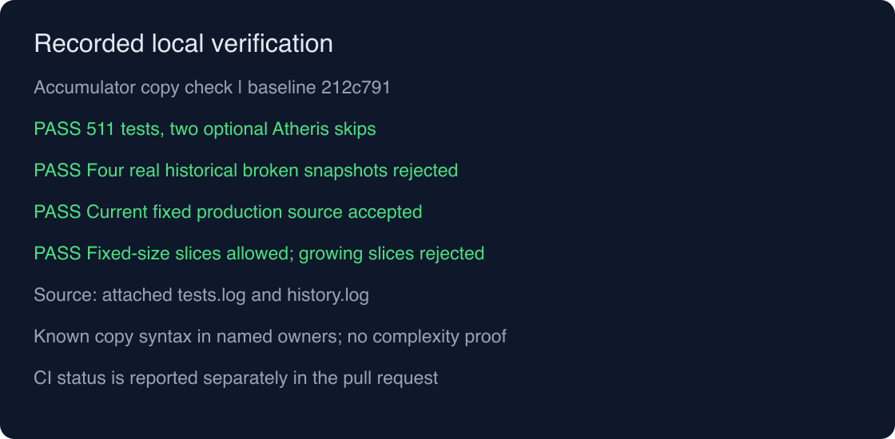

# Accumulator copy check evidence

Repeated copies of growing collections caused naming and ownership regressions.
The state-machine refactor repeated the same pattern in traversal stacks and lexical lookups.
The runtime fixes already use shared maps, linked frames, and scope positions.

`scripts/check_accumulator_copies.py` protects those existing choices. Its single `RULES` table scopes each check to a module and an owner, and supplies the replacement in its diagnostic. Explicit former owner names keep historical controls reproducible after a transition moves.
The check uses syntax, not elapsed-time thresholds.

## Historical controls

The same candidate check ran on source trees extracted from these actual commits:

| Source commit | Regression present | Expected and observed exit |
| --- | --- | --- |
| `9e9572a09dc1f817305d25fd73472d6754aa8458` | Naming accumulation before `f29f333` | 1 |
| `76d32b58389e4a65aa7cdbdd5081f3a6cbe75a20` | Ownership allocation before `c0e5122` | 1 |
| `3a03151ce4effb1c12c4a4b9da4fcccb79dcd690` | Dataflow traversal before `8efd1da` | 1 |
| `1bb6fadda4797afff8e70d28248e2a477ea2f38b` | Lexical lookups before `3a03151` | 1 |
| `212c7918ae1cb2e144ed1f6e4cf507a211727e69` | Current fixed production source | 0 |

[The recorded output](history.log) contains the actual file, owner, and replacement diagnostics. These are four broken snapshots, not four independent incidents. Several snapshots contain more than one affected owner.

To repeat a historical control from this checkout, substitute a commit above for `REV`. The history must be available locally.

```sh
history_dir=$(mktemp -d)
git archive REV src/messpy | tar -x -C "$history_dir"
python scripts/check_accumulator_copies.py --source-root "$history_dir"
rm -rf "$history_dir"
```

## Local verification

- `python scripts/check_accumulator_copies.py`: exit 0 on the candidate.
- `python -m unittest discover -s tests`: 511 tests pass, with two expected optional Atheris skips. [Output](tests.log).
- `python scripts/generate_rule_docs.py --check`: exit 0.
- Production source self-analysis: exit 0 through `scripts/verify_self_analysis.py`. This scans `src/messpy`, not the new development check.

The eight new acceptance tests invoke the actual check as a subprocess. They cover historical copy shapes, the existing replacements, fixed-size and growing slices, policy scope, and missing or invalid protected files.

[Independent review and resolutions](review.md) record the user-approved reviewer substitution and the two low findings addressed.



This panel summarizes the attached command output. It is not a screenshot of CI.

## Enforcement level and limits

Architecture already provides the shared state owners. Python annotations cannot express the allocation cost of a transition.
The CI check rejects the known regression syntax and names the existing replacement.

The check covers named owners in six modules, including tuple `+=` and known expansions, unions, concatenations, and growing slices. It does not follow aliases or helper calls, detect unrecorded owner renames, or prove algorithmic complexity. A change to an owner still requires cost review and a corresponding policy update.
